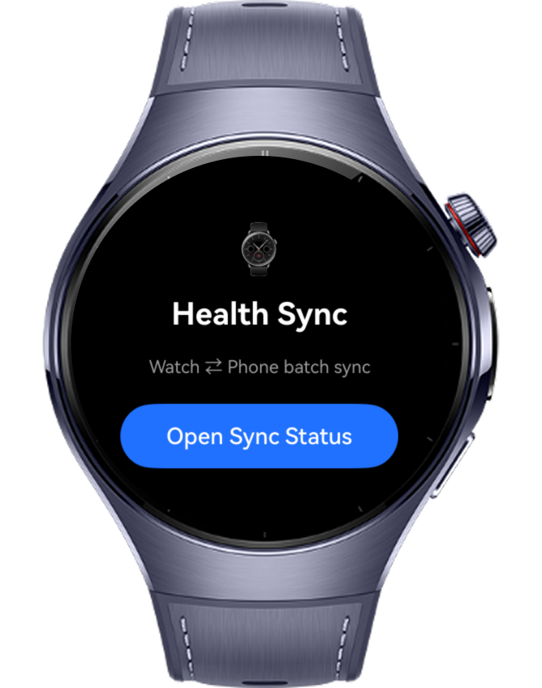
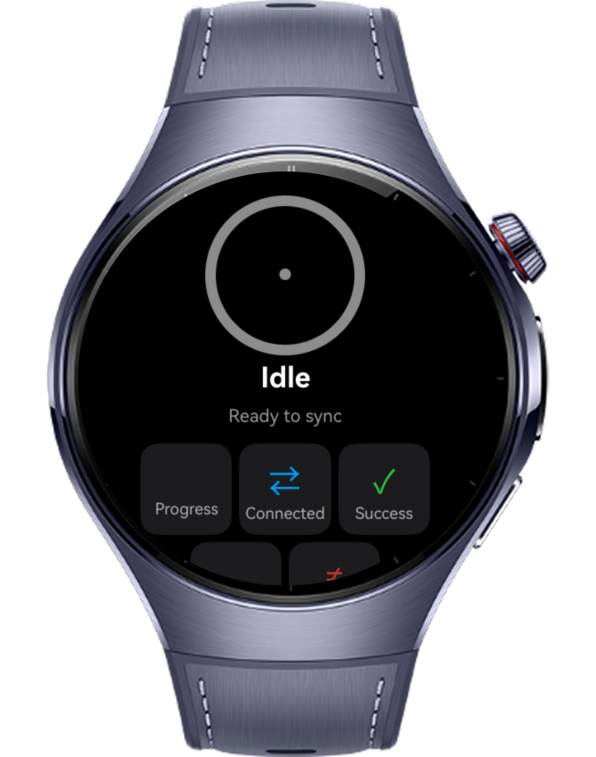
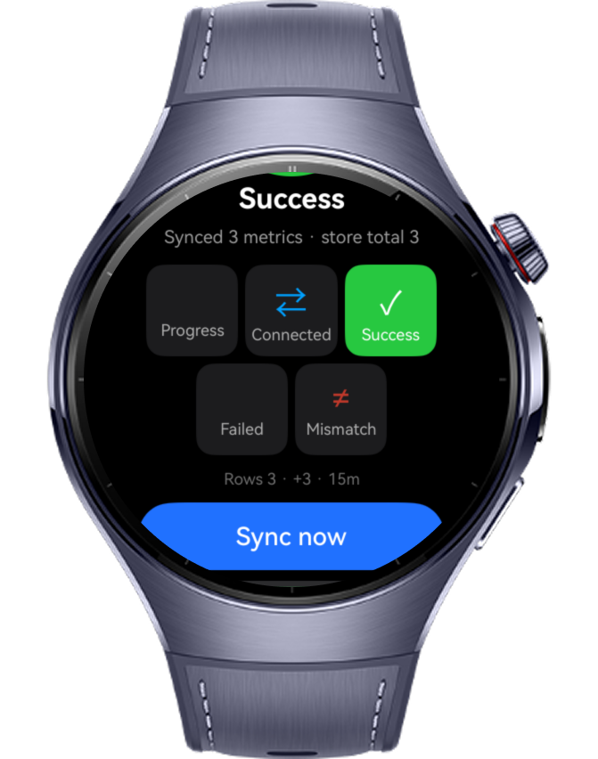
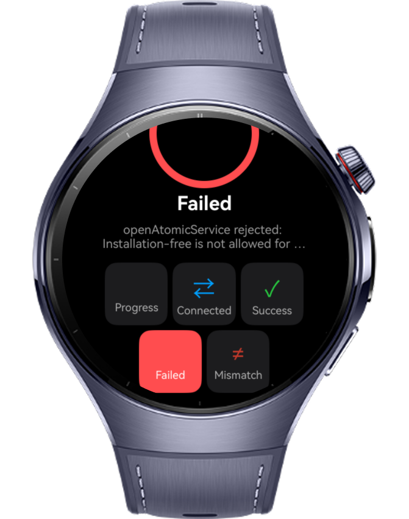

> **Note:** To access all shared projects, get information about environment setup, and view other guides, please visit [Explore-In-HMOS Index](https://github.com/Explore-In-HMOS/hmos-index).

# How To Build Data Ability Operations

The **How To Build Data Ability Operations** application is a HarmonyOS wearable application that demonstrates how to batch-synchronize health metrics (timestamps, step counts, heart rate) between a round smartwatch and a phone-side data provider using atomic multi-row transactions and remote ability-readiness gating. It combines an atomic RDB batch engine, a real ability / atomic-service readiness gate, and a circular-screen-aware status UI to solve reliable, resumable health-data synchronization on a round wearable.

# Preview

<div>
    
    
    
    
</div>

# Use Cases

- Tap **Sync now** to push a multi-row health batch (timestamp, step count, heart rate) into the on-device store as a single atomic transaction.
- The status ring, state label, and 5-state matrix update in real time as the sync advances through Progress → Connected → Success (or Failed / Mismatch).
- The layout reads the round screen via `@ohos.display` and centers all content in a circle-safe band; the home page pushes the status page through a `Navigation` / `NavPathStack` stack.
- **Cross-device** gates the batch on the phone-side target using the real `CompletionHandler` / `CompletionHandlerForAtomicService`, so data is written only after the target confirms it is fully started.
- When the target is unavailable (e.g. no paired phone), the app surfaces a graceful **Failed / TARGET_NOT_READY** state instead of crashing, and retries transient/connection-timeout faults with exponential backoff.
- Every synced row is persisted in a local `relationalStore` (RDB) table and tagged with a per-run batch id; the running row total is shown and survives app restarts.
- On a row-count mismatch the whole batch rolls back (transaction rollback plus a compensating delete by batch id); **Clear** resets the store so the flow can be re-run from zero.

# Technology

## Stack

- **Languages**: ArkTS / ArkUI (Stage model)
- **Frameworks**: HarmonyOS SDK 6.1.1(24)
- **Tools**: DevEco Studio 6.0.1 (matching HarmonyOS SDK API 24)
- **Libraries**:
    - `@kit.AbilityKit` (`UIAbility`, `common`, `Want`, `StartOptions`, `AtomicServiceOptions`, `CompletionHandler`, `CompletionHandlerForAtomicService`, `FailureCode`, `bundleManager`)
    - `@kit.ArkData` (`relationalStore`)
    - `@kit.ArkUI` (`@ohos.display`, `Navigation` / `NavPathStack` / `NavDestination`)
    - `@kit.ArkTS` (`util`)
    - `@kit.PerformanceAnalysisKit` (`hilog`)
    - `@kit.BasicServicesKit` (`BusinessError`)

# Directory Structure

```
HowToBuildDataAbilityOperations/
├── AppScope/
│   ├── app.json5
│   └── resources/
├── entry/
│   └── src/main/
│       ├── ets/
│       │   ├── common/
│       │   │   ├── SyncTypes.ets          # enums, HealthMetric, SyncError, SyncOutcome
│       │   │   ├── Logger.ets             # hilog wrapper
│       │   │   └── ScreenMetrics.ets      # @ohos.display round-screen safe band
│       │   ├── health/
│       │   │   ├── HealthDataStore.ets    # relationalStore atomic batch + rollback
│       │   │   ├── HealthSyncBridge.ets   # orchestrator: gate → batch → validate → retry
│       │   │   ├── RemoteReadinessGate.ets# CompletionHandler / CompletionHandlerForAtomicService
│       │   │   └── SyncIntervalAdvisor.ets# context-aware sync cadence
│       │   ├── entryability/
│       │   │   └── EntryAbility.ets
│       │   ├── entrybackupability/
│       │   │   └── EntryBackupAbility.ets
│       │   └── pages/
│       │       ├── Index.ets              # home page (Navigation host)
│       │       └── SyncStatusMatrix.ets   # responsive round status matrix (NavDestination)
│       ├── module.json5
│       └── resources/
├── build-profile.json5
├── hvigorfile.ts
└── oh-package.json5
```

# Constraints and Restrictions

## Supported Devices

- This demo is supported on **HarmonyOS Wearables** (deviceTypes: `wearable`).
- HarmonyOS wearable emulators and physical round-screen devices are supported for development and testing.
- Cross-device synchronization requires the `ohos.permission.DISTRIBUTED_DATASYNC` permission and a paired phone running the health data provider (or a target atomic service).

## App Limits

- The cross-device path requires a phone-side DataShare / atomic-service provider; on a standalone wearable emulator it intentionally reports `TARGET_NOT_READY`, since data abilities and remote targets cannot be resolved without a paired device.
- The `usageStatistics.queryAppGroup()` App-Standby signal is disabled in the compiled build (the `usageStatistics` namespace is not usable as a value under the strict ArkTS toolchain); a dependency-free time-of-day heuristic is used instead, with the real version kept under `reference/stage-usagestats/`.
- Async RDB writes, distributed ability launch, and `CompletionHandler` readiness callbacks may not behave fully in the DevEco Previewer — use a wearable emulator or a physical device to exercise the full flow.
- `CompletionHandler` and `CompletionHandlerForAtomicService` require API version 20+ and are declaration-only classes, so they are provided as object-literal handlers (they cannot be `extends`ed or `implements`ed).

# License

**How To Build Data Ability Operations** is distributed under the terms of the MIT License.  
See the [LICENSE](/LICENSE) for more information.
